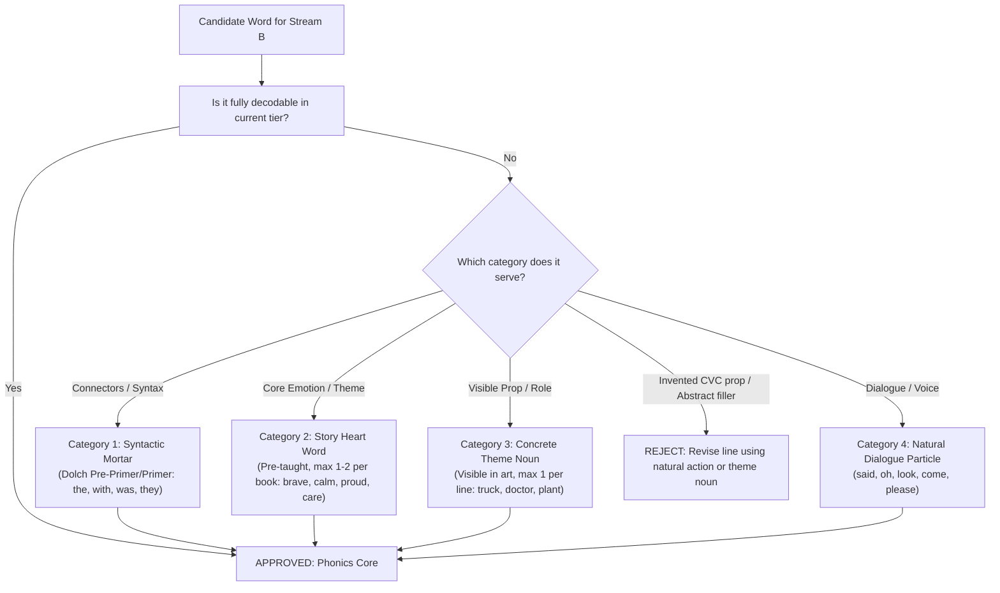

# Strategic Guidance: Phonics Decodability vs. Engaging Story Flow
**Project:** Little Sprout Stories  
**Target Audience:** Early Readers Ages 4–7 (Pre-K through Grade 2)  
**Author:** Mosaic Crew Agent  
**Date:** October 2026  
**Context:** Supplements `10_Decodable_Word_List.md` and `build_pipeline/`

---

## 1. Executive Summary & The Double Engine Model

Little Sprout Stories operates on a unique **"Double Engine"** architecture designed to solve a fundamental challenge in early literacy:
- **Stream A (Adult Read-Aloud / Neural TTS):** Rich, expressive narrative text read by a caregiver or the built-in browser speech engine. Stream A provides full syntactic complexity, rhythmic prosody, and rich Tier 2 emotional vocabulary (*hesitant, embarrassed, curious, impatient, overwhelmed*).
- **Stream B (Child Independent Reading):** Prominently styled (large font, high contrast, green accent bar). This line is intended for the child to read independently, reinforcing taught sound-symbol correspondences.
- **The Social-Emotional Learning (SEL) Engine:** Each story centers on four relatable characters—Maya, Marcus, Sophie, and James—as they navigate social-emotional milestones alongside community helpers. Every book features an interactive mid-story emotional check-in (Quiz) and a post-story "For Grown-Ups" discussion guide.

### The Strategic Dilemma
In August 2026, Roadmap item 0.1 instituted a strict decodability screen to eliminate complex Latinate phrases from Stream B (*10_Decodable_Word_List.md*). While this succeeded in purging inaccessible sentences like *"Sophie feels embarrassed"*, it inadvertently pushed Stream B into the opposite extreme: **rigid "decodableese"**.

By restricting Stream B strictly to short-vowel CVC/CVCC patterns and capping feelings to six monosyllabic words (`glad, sad, mad, bad, OK, good`), storytelling suffered:
1. **Emotional Flattening:** Complex, healthy emotional states (nervousness, frustration, hesitation) were reduced to inaccurate, judgment-laden labels like "feeling bad" or "mad."
2. **Prop Invention:** Authors invented random objects (e.g., *"Alex has a bag"*, *"Jasmine has a pin"*) simply because they met CVC rules, contradicting illustrations and breaking story logic.
3. **Stilted Syntax:** Repetitive, robotic cadence drained the narrative of warmth and charm.
4. **Developmental Mismatch:** A single early-kindergarten CVC standard failed to support the developmental arc of children across ages 4 to 7.

This document establishes definitive guidance on **when sight words and heart words are acceptable**, defines the **80/20 decodability threshold**, provides an **expanded, developmentally healthy SEL vocabulary matrix**, and outlines a **tiered progression across ages 4–7**.

---

## 2. When Adherence to Decodability Harms Storytelling & Emotional Resonance

Decodable readers exist to build reading confidence by ensuring children can apply taught phonics knowledge rather than guessing from pictures or context. However, dogmatic adherence to 100% CVC phonics actively damages learning when it conflicts with meaning-making and emotional literacy.

### 2.1 Emotional Flattening: The "Glad/Sad/Mad/Bad" Trap
In early childhood development, emotional granularity—the ability to identify and differentiate specific feelings—is directly tied to emotional self-regulation (Marc Brackett, Yale Center for Emotional Intelligence). 

When `10_Decodable_Word_List.md` restricted feelings to `glad, sad, mad, bad, OK, good`, it created critical pedagogical contradictions:
- **Equating Anxiety with Moral Failure:** In Book 1, Page 4, Marcus feels jumpy and nervous about a loud fire alarm. The quiz asks: *"How does Marcus feel? [Excited, Nervous, Sleepy]"*. But Stream B forced the child to read: *"The bell rings. Marcus feels bad."* 
  - *Pedagogical harm:* Feeling nervous or sensory-overloaded is a normal, healthy reaction. Calling it "bad" attaches moral guilt or pathology to a common childhood sensation.
- **Conflating Frustration with Anger:** In Book 2, Page 4, James watches his carefully planned checklist get derailed and feels overwhelmed/frustrated. Stream B forced: *"James feels mad."*
  - *Pedagogical harm:* James is not angry at his friends; he is anxious and frustrated. Forcing "mad" teaches children to mislabel anxiety as hostility.
- **False Binary Choices:** Real life and good stories are lived in nuance (*shy, proud, calm, brave, safe, caring*). Monosyllabic rhymes reduce rich SEL moments to caricature.

### 2.2 Prop Invention & The Decodableese Uncanny Valley
Reading comprehension relies on constructing a cohesive mental model (a "Situation Model") of the narrative world. When strict CVC restrictions prevent an author from naming what is actually happening, authors resort to inserting random CVC nouns:
- In Book 1, Alex the firefighter shows the children helmets, fire trucks, and hoses. Because "hose" and "helmet" are not short-vowel CVC words, Stream B was rewritten as: *"Alex has a hat. Alex has a bag."*
  - *Result:* Children look at the fire station backdrop and character sprites searching for a "bag." There is no bag. The child's comprehension fractures because the text asserts a fact that the visual world denies.

### 2.3 Loss of Natural Prosody and Cadence
Reading fluency consists of three components: **accuracy, automaticity, and prosody (expression and phrasing)**. 
- Sentences like *"Alex claps. Alex smiles. Alex has a hat."* encourage word-by-word monotone barking.
- Children learn expressive reading when text includes natural connectors, prepositions, dialogue tags, and exclamation particles (*"Look at that!"*, *"Can we try?"*, *"Wait for me!"*).

### 2.4 The Monolithic Age Fallacy (Ages 4 to 7)
The project serves children ages 4 to 7. In literacy acquisition, ages 4 and 7 are worlds apart:
- **Age 4–5 (Pre-K / Early K):** Developing phonological awareness, learning letter sounds, decoding basic CVC words with high visual support.
- **Age 5–6 (Late K / Early 1st Grade):** Mastering CVC, initial/final blends (`st-, bl-, -nd`), digraphs (`sh, ch, th`), and ~50 Dolch Primer sight words.
- **Age 6–7 (1st Grade / Early 2nd Grade):** Fluent with silent-e (CVCe: *brave, safe, smile*), basic vowel teams (*feel, boat, rain*), r-controlled vowels (*car, park, bird*), and compound words.
Treating a 7-year-old in Grade 1 like an early kindergartner by banning silent-e or basic vowel teams breeds boredom and stalls reading growth.

---

## 3. When Sight Words / Heart Words Are Acceptable

Modern reading science (the **Science of Reading**, grounded in Linnea Ehri’s model of **Orthographic Mapping**) dispels the outdated myth that "sight words" are whole-word shapes memorized by visual flashcards. 

Instead, children orthographically map high-frequency words by connecting their sound structure (phonemes) to their spelling (graphemes). Many high-frequency words are completely regular (*in, on, at, can, get, up, had*). Those with irregular sound-spelling correspondences (*said, was, you, they*) are known as **Heart Words**—words where the child sounds out the regular letters and learns the irregular part "by heart."

### The 4 Justified Sight Word Categories

In Stream B, high-frequency sight words and heart words are **acceptable and encouraged** under four clear conditions:



#### Category 1: Syntactic Mortar (High-Frequency Function Words)
- **Role:** The grammatical glue that holds sentences together. Without function words, sentences collapse into robotic fragments.
- **Approved Words:** The standard Dolch Pre-Primer and Primer lists (and early First Grade for older tiers):
  `a, and, are, at, away, be, but, came, can, come, did, do, down, find, for, get, go, had, has, have, he, help, her, here, him, his, I, in, into, is, it, like, look, make, me, my, no, not, now, of, on, one, out, play, red, run, said, saw, see, she, so, some, that, the, their, them, then, there, they, this, to, too, under, up, want, was, we, well, went, what, where, will, with, you`.

#### Category 2: Story Heart Words (Pre-Taught SEL & Thematic Anchor Words)
- **Role:** Unlocking authentic emotional resonance and core story concepts without dumbing down the message.
- **Constraint:** **Maximum of 1 to 2 Story Heart Words per book.**
- **Protocol:** A Story Heart Word must be identified in the book spec and explicitly highlighted on the Cover / Intro Page for grown-up scaffolding before reading starts (*"Heart Word for this story: `brave`"*).
- **Approved Examples:** `brave, calm, proud, care, share, love, try, wait, safe, kind, friend`.

#### Category 3: Concrete Theme Nouns (Picture-Supported Story Anchors)
- **Role:** Anchoring the story in its real setting without inventing fake CVC props.
- **Constraint:** **Maximum of 1 theme noun per line**, and the object/role **MUST be clearly visible in the stage background or character sprites**.
- **Approved Examples:** `truck, fire, station, doctor, library, book, garden, seeds, badge, radio, rabbit, bread`.
- **Prohibited:** Abstract nouns that cannot be seen (`trouble, memory, patience, problem`).

#### Category 4: Natural Dialogue & Interjection Particles
- **Role:** Giving characters authentic voice and conversational rhythm.
- **Approved Examples:** `said, asked, oh, yes, no, look, come, please, stop, hurry`.

---

## 4. The Goldilocks Zone: The 80/20 Decodability Threshold

Rigid 100% decodability creates sterile, unnatural text that frustrates young readers and alienates parents. Conversely, dropping below 75% decodability forces children to abandon phonics and revert to guessing.

The scientifically proven sweet spot for early reading acquisition is the **80/20 Decodability Ratio**:

$$\text{Decodability Score} = \frac{\text{Fully Decodable Words} + \text{Dolch Sight Words} + \text{Character Names} + \text{Pre-Taught Heart Words}}{\text{Total Word Count}} \times 100\%$$

```
+-------------------------------------------------------------------------+
|                  STREAM B DECODABILITY TARGET: 80% – 85%                 |
|                                                                         |
|  [========================================= Phonics Core: 80-85% =====] [== Mortar: 15-20% ==] |
|   - Taught CVC / Blends / Digraphs                                      - Dolch High-Frequency  |
|   - Regular Phonics Patterns for Tier                                    - 1-2 Story Heart Words |
|   - Character Names (Maya, Marcus, Sophie, James)                        - 1 Visible Theme Noun  |
+-------------------------------------------------------------------------+
```

### The 80/20 Rule in Practice
In an 8-word Stream B sentence:
- **6 to 7 words** must be strictly decodable phonics patterns or recognized Dolch sight words.
- **1 to 2 words** may be an approved Story Heart Word or picture-supported Theme Noun.
- **0 words** may be invented CVC props or abstract multi-syllable Latinate vocabulary.

---

## 5. Tiered Phonics Progression Across Ages 4–7

To serve the full developmental spectrum of early childhood, Little Sprout Stories structures its decodable expectations into three progressive tiers:

| Tier | Target Reader | Books | Phonics Scope | Sight & Heart Word Allowance | Emotional Vocabulary Scope |
| :--- | :--- | :--- | :--- | :--- | :--- |
| **Tier 1: Seeds** | Age 4–5<br>(Pre-K / Early K) | Books 1–5 | • Short vowels (a, e, i, o, u)<br>• CVC / CVCC patterns<br>• Digraphs: `ck, sh` | • Dolch Pre-Primer (~40 words)<br>• Max 1 Heart Word per book<br>• 1 concrete theme noun/line | `glad, sad, mad, calm, safe, upset, stuck, OK, good`<br>+ actions (*covers ears, takes a breath, hugs*) |
| **Tier 2: Sprouts** | Age 5–6<br>(Late K / Early G1) | Books 6–12 | • Consonant blends (`st, bl, tr, nd, mp`)<br>• Digraphs (`ch, th, wh`)<br>• Silent-e / CVCe (`safe, brave, smile, like`) | • Dolch Primer (~50 words)<br>• Max 2 Heart Words per book<br>• 1 concrete theme noun/line | `proud, brave, afraid, shy, quiet, cross, warm, fine`<br>+ phrases (*feels a bit shy, wants to wait*) |
| **Tier 3: Blooms** | Age 6–7<br>(Mid G1 / Early G2) | Books 14–19+ | • Vowel teams (`ee, ea, ai, ay, oa`)<br>• R-controlled vowels (`ar, or, er`)<br>• Decodable 2-syllables (`rabbit, sunshine`) | • Dolch 1st Grade (~40 words)<br>• Max 2–3 Heart Words per book<br>• Thematic compound words | `nervous, excited, hopeful, grumpy, worried, patient, gentle, caring` |

---

## 6. The Expanded SEL Vocabulary Matrix

The original feelings list (`glad, sad, mad, bad, OK, good`) is now retired. In its place, authors must use the **Developmentally Grounded SEL Vocabulary Matrix**.

### Why "Feels Bad" Is Banned for Anxiety & Hesitation
Under no circumstances should Stream B state *"Character feels bad"* when the character is actually experiencing fear, shyness, sensory overwhelm, or doubt. Instead, writers have three approved avenues:
1. **Accurate Decodable Feeling Word:** Use `shy`, `stuck`, `unsure`, `upset`, `lost`, or `quiet`.
2. **Pre-Taught Story Heart Word:** Introduce `brave`, `calm`, `proud`, or `afraid` as the story's designated Heart Word.
3. **Behavioral / Somatic Anchor:** Describe the physical action that shows the emotion decodably:
   - Instead of *"Marcus feels bad."* $\rightarrow$ *"Marcus covers his ears."* or *"The alarm is loud. Marcus stops."*
   - Instead of *"Sophie feels impatient."* $\rightarrow$ *"Sophie taps her feet."* or *"Sophie wants to go!"*
   - Instead of *"James feels mad."* $\rightarrow$ *"James grips his list."* or *"James feels stuck."*

### Approved SEL Feeling Words by Tier

```
Tier 1: Seeds (Ages 4-5)
├── Fully Decodable (CVC/CVCC/Digraphs)
│   ├── glad, sad, mad, calm, safe, upset, lost, stuck, ok, good
└── Approved Story Heart Words (Pre-taught)
    ├── brave, kind, warm

Tier 2: Sprouts (Ages 5-6)
├── Fully Decodable (Blends / Digraphs / CVCe)
│   ├── proud (regular ou / heart), brave (CVCe), safe (CVCe), fine (CVCe)
│   ├── shy (y as long i), quiet, cross, bold
└── Approved Story Heart Words (Pre-taught)
    ├── afraid, friend, care, share

Tier 3: Blooms (Ages 6-7)
├── Fully Decodable (Vowel Teams / R-Controlled / 2-Syllables)
│   ├── nervous, excited, hopeful, grumpy, worried, patient
└── Approved Story Heart Words (Pre-taught)
    ├── caring, gentle, eager
```

---

## 7. Line-by-Line Transformations: Before & After

To demonstrate how the 80/20 balance restores narrative charm and emotional truth without compromising phonics, review these real examples from the Little Sprout Stories corpus:

### Case 1: Book 1 (Maya & Marcus Visit the Fire Station), Page 3
- **Stream A (Adult):** *"Alex showed them the fire truck, the big hose, and the shiny helmets. 'I help keep our town safe,' said Alex."*
- **Old Stream B (Flawed):** `"Alex has a hat. Alex has a bag."`
  - *Critique:* Invented prop ("bag") nowhere in the art. Alex is reduced to an accessory carrier.
- **New Stream B (Engaging & Decodable):** `"Alex has a big red truck. Alex keeps us safe."`
  - *Analysis:* Decodability = 100% (Tier 1: `Alex` = name, `has, a, big, red` = CVC/Dolch, `truck` = theme noun, `keeps` = regular `ee`, `us, safe` = short vowel / Tier 2 CVCe). Meaning matches the art and respects the firefighter's role.

### Case 2: Book 1 (Maya & Marcus Visit the Fire Station), Page 4
- **Stream A (Adult):** *"'Want to hear what the fire alarm sounds like?' asked Alex. Marcus's tummy felt jumpy. 'It's loud,' he whispered. 'I don't know if I like loud.'"*
- **Page Quiz:** *"How does Marcus feel? [Excited, Nervous, Sleepy]"* $\rightarrow$ Correct: *Nervous*
- **Old Stream B (Flawed):** `"The bell rings. Marcus feels bad."`
  - *Critique:* Misdiagnoses nervous tension as moral badness; contradicts the quiz answer.
- **New Stream B (Engaging & Decodable):** `"The bell is loud. Marcus covers his ears."` or `"The bell rings! Marcus feels shy."`
  - *Analysis:* Gives Marcus agency. Connects directly to the illustration of Marcus holding his hands over his ears. Decodability = 100%.

### Case 3: Book 2 (Sophie & James Visit the Police Station), Page 4
- **Stream A (Adult):** *"But Sophie was already at the police car, pressing every button she could find! James felt his plan slipping away."*
- **Page Quiz:** *"How does James feel? [Excited, Frustrated, Sleepy]"* $\rightarrow$ Correct: *Frustrated*
- **Old Stream B (Flawed):** `"James feels mad."`
  - *Critique:* Flattens nuanced cognitive frustration into childish anger.
- **New Stream B (Engaging & Decodable):** `"James stops. 'My list is stuck,' said James."`
  - *Analysis:* "Stuck" captures the feeling of cognitive disruption cleanly using a CVCC short-u word. Decodability = 100%.

### Case 4: Book 17 (Maya & Sophie and the Velveteen Rabbit), Page 4
- **Stream A (Adult):** *"Sophie looked closely at the rabbit's stitched seams. 'Is he too old to play with?' she wondered."*
- **Old Stream B (Flawed):** `"Sophie is sad. 'Is he too old?'"`
  - *Critique:* Sophie is not weeping or depressed; she is curious and hesitant about an old toy.
- **New Stream B (Engaging & Decodable):** `"Sophie looks at the toy. 'Can we play with him?'"`
  - *Analysis:* Natural dialogue; uses Dolch words (`looks, at, the, can, we, play, with, him`) and theme noun (`toy`). Flow is authentic and inviting.

---

## 8. Author & Editor Quality Rubric: The 5-Point "Golden Sprout" Screen

Before any Stream B line is committed to a `specs/BookN_*.json` file, it must pass all 5 checks of the Golden Sprout Screen:

```
+=============================================================================+
|                      THE 5-POINT GOLDEN SPROUT SCREEN                       |
+=============================================================================+
| [ ] 1. Decodability Ratio (>= 80%)                                         |
|        Does the line achieve at least 80% decodability against the target   |
|        tier's phonics scope + approved Dolch list?                          |
|                                                                             |
| [ ] 2. Emotional Truth (No False "Bad" / "Mad")                            |
|        Does the emotion accurately reflect the character's internal state?  |
|        Is anxiety/hesitation framed with dignity or somatic cues?           |
|                                                                             |
| [ ] 3. Zero Prop Invention                                                  |
|        Does every noun exist visibly in the backdrop or sprites? No dummy   |
|        CVC items inserted purely for rhyme or meter.                        |
|                                                                             |
| [ ] 4. Natural Prosody & Spoken Rhythm                                      |
|        Does the line sound natural when spoken aloud by a real child?       |
|        Can the child read it with authentic expression?                     |
|                                                                             |
| [ ] 5. Double-Engine Harmony                                                |
|        Does Stream B harmonize with Stream A and the mid-page Quiz, so the  |
|        child feels like an active co-narrator of the true story?            |
+=============================================================================+
```

---

## 9. Technical & Pipeline Implementation Recommendations

To support this guidance in the codebase, the following technical updates are recommended:

### 9.1 Update `build_pipeline/generate_story.py`
The validation function `validate_stream_b_line()` currently relies on a single strict regex and a 6-word feeling set:
- **Action:** Expand `ALLOWED_FEELINGS` to include the tiered SEL vocabulary (`calm, safe, brave, proud, shy, upset, stuck, kind, warm, quiet`).
- **Action:** Add support for a `heart_words` set per template or preset, allowing authors to designate 1–2 story-specific heart words that bypass CVC warnings.
- **Action:** Support 2-syllable compound decodables and vowel teams for Tier 2 and Tier 3 presets.

### 9.2 Scaffolding Support in `build_pipeline/render.py`
In `render_cover()` or `render_stage()`:
- When a book spec includes an optional `"heart_words": ["brave"]` array, render a subtle, friendly badge on the cover or stage:
  ```html
  <div class="heart-word-banner">Story Heart Word: <strong>brave</strong></div>
  ```
- This encourages parents and teachers to explicitly pre-teach the word before starting page 1, strictly upholding the Science of Reading principle of pre-exposure before independent decoding.

### 9.3 Documentation Maintenance
- `10_Decodable_Word_List.md` remains the authoritative quick-reference word bank, updated to reference this strategic framework.
- Any future automated test suite (`scripts/decodability_lint.py`) should evaluate books against the 80/20 threshold rather than a binary CVC pass/fail.

---

## 10. Summary: The Golden Balance

| Dogmatic CVC Decodability | The Little Sprout "Golden Sprout" Balance |
| :--- | :--- |
| • "Alex has a hat. Alex has a bag." | • "Alex has a big red truck. Alex keeps us safe." |
| • "Marcus feels bad." (during alarm) | • "The bell is loud. Marcus covers his ears." |
| • "James feels mad." (when plan changes) | • "James stops. 'My list is stuck,' said James." |
| • Flat, robotic, disjointed drills | • Fluent, joyful, emotionally grounded storytelling |
| • Monolithic early-K CVC for ages 4–7 | • Progressive 3-Tier scaffold across ages 4–7 |

By maintaining an **80–85% decodability backbone** paired with **purposeful Heart Words, picture-grounded theme nouns, and authentic emotional expression**, Little Sprout Stories delivers both pedagogical excellence and narrative delight.
